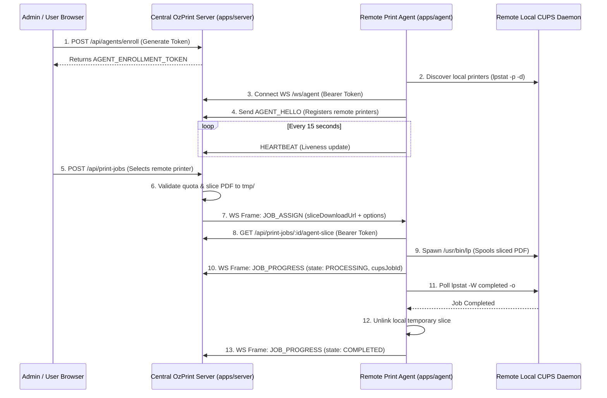

# OzPrint — Agents Guide (`AGENTS.md`)

This document serves two audiences:
1. **System Administrators & Self-Hosters**: Explains what **OzPrint Remote Print Agents** (`apps/agent`) are, how they compare to **Direct Server Printing**, and how to deploy them.
2. **Developers & AI Coding Agents**: Defines the repository architecture, security invariants, and verification commands required when modifying the OzPrint codebase.

---

## Part 1: OzPrint Remote Print Agents vs. Direct Server Printing

### 1.1 Do You Need a Remote Print Agent?

**In most single-server or homelab setups, NO.**

| Deployment Scenario | Recommended Mode | How It Works |
| :--- | :--- | :--- |
| **Single Server / Homelab / Office LAN**<br>*(Your printer is plugged into the OzPrint Linux server via USB, or reachable on the same LAN/Wi-Fi)* | **Direct Server Printing**<br>(`LocalCupsAdapter`) | The main OzPrint server (`apps/server`) runs directly on the machine connected to the printer. It invokes local CUPS (`/usr/bin/lp`, `/usr/bin/lpstat`) directly. **No agent is needed.** |
| **Cloud VPS or Multi-Branch Office**<br>*(OzPrint runs on a cloud server or HQ, while the printer is on a separate remote network behind NAT/firewall)* | **Remote Print Agent**<br>(`RemoteAgentAdapter` + `apps/agent`) | A lightweight daemon (`apps/agent`) runs on a Raspberry Pi or Linux box next to the remote printer and connects **outbound** to the central OzPrint server over WebSockets (`WS /ws/agent`). |

---

### 1.2 How the Direct Server Mode Works (Default)

When you deploy OzPrint directly on your print server:
1. You open OzPrint in your browser (`http://<server-ip>:4000` or via Tailscale / Cloudflare Tunnel).
2. In **Admin → Registered Printers**, click **Scan CUPS (`lpstat`)**.
3. OzPrint runs `/usr/bin/lpstat -p -d` and `/usr/bin/lpoptions -p <printer> -l` directly on the server to discover your attached printer and its hardware capabilities (duplex, color, paper sizes).
4. When you click **Slice & Print**, OzPrint slices the exact requested pages into `tmp/slice_<jobId>.pdf`, spawns `/usr/bin/lp`, tracks physical completion via `/usr/bin/lpstat -W completed -o`, and deletes the temporary slice immediately.

> [!NOTE]
> **CUPS Driver / PPD Boundary**: OzPrint submits standard PDFs to `/usr/bin/lp` without `-o raw` and delegates printer-language rasterization entirely to CUPS. If a printer prints raw binary headers (e.g., `dsnd` from `rastertoescpr` on an Epson L380 configured with an `ESC/P-R` L385 PPD), the issue is the host CUPS PPD/driver (`printer-driver-gutenprint` or vendor driver mismatch), not `LocalCupsAdapter`. Verify directly with `lp -d <printer> /usr/share/cups/data/testprint` and `/etc/cups/ppd/<printer>.ppd`.

---

### 1.3 How the Remote Print Agent Works (Layer 3 Distributed Mode)



#### Step-by-Step Remote Agent Setup
1. **Enroll the Agent in OzPrint**:
   - Log in to the OzPrint web UI as an `ADMIN`.
   - Open **Admin, CUPS & Agents** → **Remote Print Agents**.
   - Enter a name (e.g., `Branch-Office-Pi`) and click **Enroll Agent**.
   - Copy the one-time `AGENT_ENROLLMENT_TOKEN=ozagent_...` token.
2. **Start the Agent on the Remote Printer Host**:
   ```bash
   export OZPRINT_SERVER_URL="https://print.example.com"
   export AGENT_ENROLLMENT_TOKEN="ozagent_your_token_here"
   npm --workspace=apps/agent run start
   ```
3. **Print**:
   - Any CUPS printer attached to that remote host will automatically appear in the OzPrint printer selector with `[Remote Agent • IDLE]`.

---

## Part 2: Instructions for Developers & AI Coding Agents

When contributing to or modifying this repository, adhere strictly to the following architectural and security invariants:

### 2.1 Repository Map
- `apps/server/` — Node.js 20 + Express + TypeScript modular monolith:
  - `src/security/sandbox.ts` — Canonical path guard (`resolveSafeStoragePath`), printer ID validator (`validateSafePrinterName`), and zero-shell binary runner (`runSafeBinary`).
  - `src/core/pageResolver.ts` — Deterministic page range, odd/even subset, reverse order, and duplex physical sheet calculator (`resolvePrintPages`).
  - `src/core/magicBytes.ts` — Raw buffer magic-byte verifier (`%PDF-`, `PNG`, `JPEG`).
  - `src/db/schema.ts` & `src/db/database.ts` — `better-sqlite3` WAL mode persistence layer with PostgreSQL-compatible SQL abstraction and immutable `audit_logs` triggers.
  - `src/adapters/` — `IPrintAdapter`, `LocalCupsAdapter`, and `RemoteAgentAdapter`.
  - `src/orchestrator/printOrchestrator.ts` — Persistent print job state machine, idempotency enforcement, atomic quota deduction/refunds, 2-second CUPS reconciliation poller, `UNKNOWN` auto-retry halt guard, and TTL cleanup worker.
  - `src/services/pdfWorkerService.ts` & `src/services/documentService.ts` — Opaque UUIDv4 storage, non-destructive revision lineage, N-Up multi-page per sheet layout engine, `pdf-lib` annotation flattening, and Python worker orchestration.
- `apps/web/` — React 18 + Vite + TypeScript + Tailwind CSS SPA (`PageSlicerAndPrintPanel`, `NupLayoutPanel`, `PdfPreviewAndMarkup`, `KioskView`, `AdminDashboard`).
- `apps/agent/` — Standalone outbound WebSocket Remote Print Agent daemon.
- `workers/pdf_worker.py` — Python 3 (`pypdf`, `pdf2image`, `Pillow`) CLI worker for PDF inspection, slicing, `PDF ↔ Image` conversion, and rasterized true redaction.
- `tests/` — Mandatory automated verification suites (`tests/unit`, `tests/security`, `tests/integration`).

### 2.2 Mandatory Security Invariants (Never Violate)
1. **Zero-Shell Subprocess Execution**:
   - Never use `child_process.exec` or `spawn(..., { shell: true })`.
   - All OS print and document binaries (`/usr/bin/lp`, `/usr/bin/lpstat`, `/usr/bin/lpoptions`, `/usr/bin/cancel`, `/usr/bin/python3`) MUST be invoked through `runSafeBinary()` in `apps/server/src/security/sandbox.ts` with `shell: false` and validated argument arrays.
2. **Opaque Storage & Canonical Path Guard**:
   - Never use user-supplied `original_filename` values as filesystem paths.
   - All storage reads and writes MUST resolve through `resolveSafeStoragePath(storageRoot, storageKey)` which verifies `fs.realpath` prefix containment and throws `SECURITY_PATH_TRAVERSAL_BLOCKED` on traversal attempts.
3. **`UNKNOWN` State Auto-Retry Halt Guard**:
   - Jobs entering `UNKNOWN` due to CUPS or Remote Agent timeouts MUST NEVER auto-retry without explicit user confirmation via `POST /api/print-jobs/:jobId/resolve-unknown` to prevent duplicate physical paper waste.
4. **Immutable Audit Trail**:
   - `audit_logs` is append-only and protected by SQLite `BEFORE UPDATE` and `BEFORE DELETE` triggers (`AUDIT_LOGS_IMMUTABLE`).

### 2.3 Verification Commands
Before submitting any changes, run:

```bash
# Run all 18 unit, security/fuzzing, and integration tests
npm test

# Verify TypeScript and Vite production builds across all workspaces
npm run build
```
