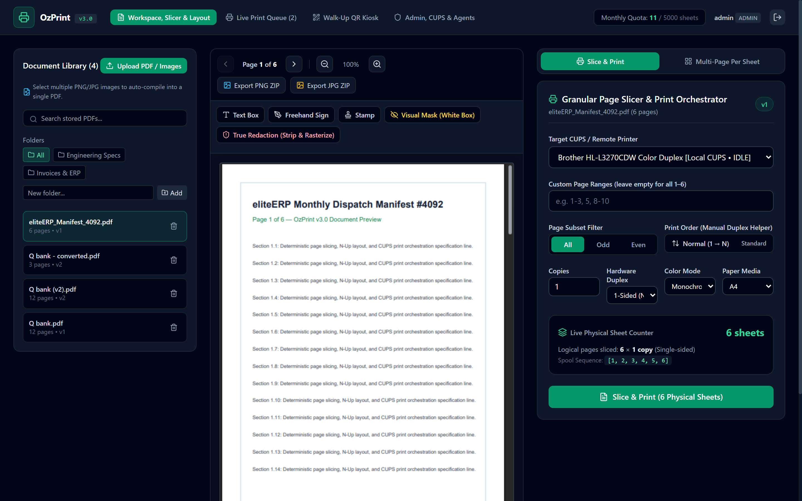
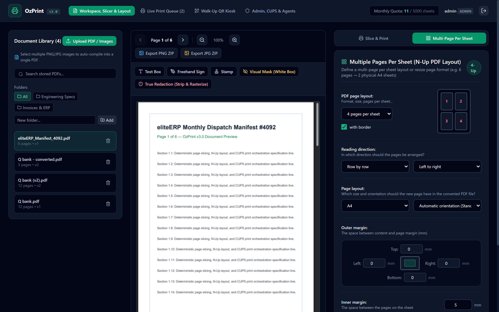
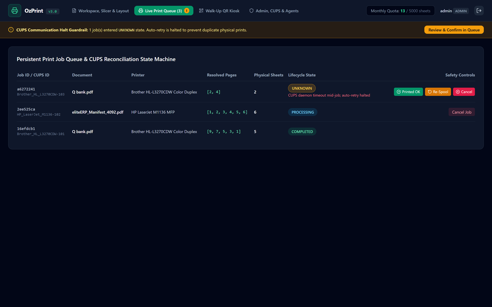
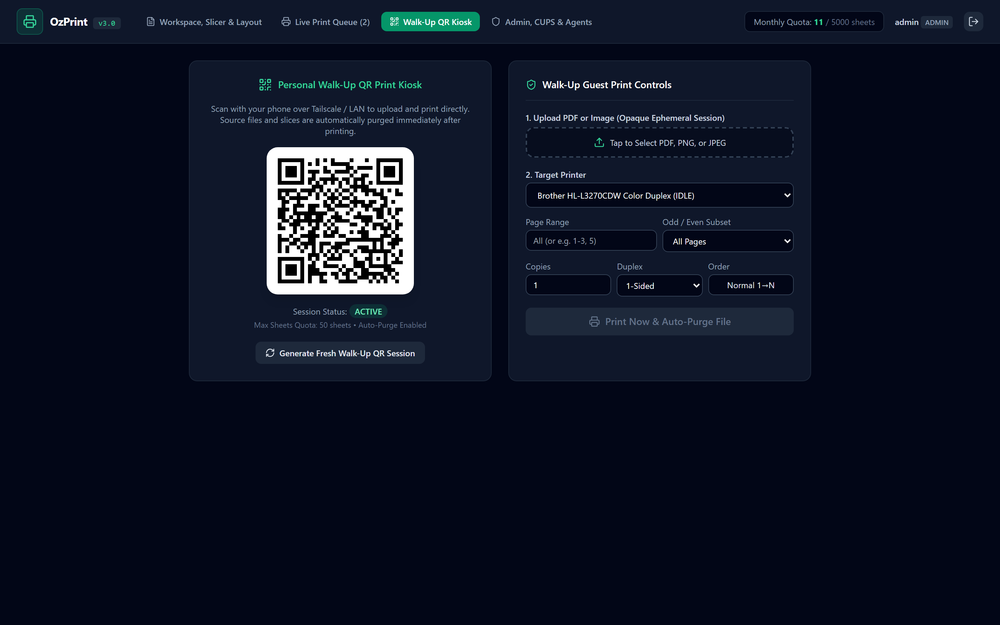
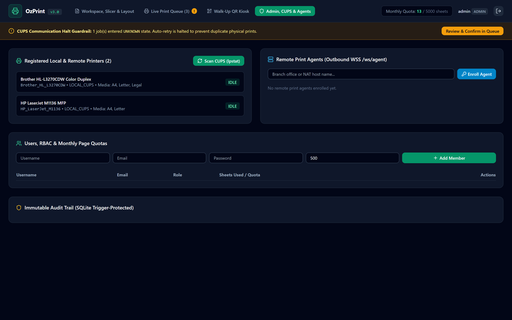
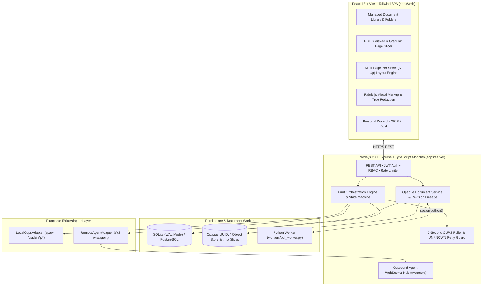

# OzPrint

### Print from anywhere in the world to your own self-hosted printer.
**A private, zero-subscription alternative to Google Cloud Print with browser PDF prep, granular page slicing, and zero port-forwarding.**

[](package.json)
[](LICENSE)
[](package.json)
[](workers/pdf_worker.py)
[](CONTRIBUTING.md)

> [!TIP]
> **Why OzPrint?**
> - 🌍 **Print From Anywhere**: Hit **Print** from your smartphone, laptop, or ERP across town or across the globe.
> - 🛡️ **Zero Port Forwarding**: Never expose your home router to internet scans or struggle with ISP CGNAT. Connect securely via **Cloudflare Tunnel**, **Tailscale**, or outbound WebSockets.
> - 🔒 **100% Private & Self-Hosted**: Your documents never touch third-party cloud print vendors (HP Smart, Epson Connect, Canon Cloud). Files are stored opaquely and automatically shredded after printing.
> - ✂️ **Smart Browser PDF Prep**: Custom page slicing, live physical sheet counters, manual duplex reversing, N-Up multi-page layouts, digital signatures, stamps, and 300 DPI true redaction before spooling a single sheet of paper.

**OzPrint** is a self-hosted, open-source web platform that unifies opaque document storage, interactive PDF.js previewing, granular page slicing (`range`, `odd/even`, `reverse` manual duplexing), multi-page-per-sheet (**N-Up**) layout conversion, non-destructive Fabric.js markup, isolated rasterized true redaction, format conversions (`PDF ↔ Images`), and physical print orchestration inside a single deployable modular monolith.



---

## Table of Contents

1. [Visual Usage Tutorial & Step-by-Step Guide](#1-visual-usage-tutorial--step-by-step-guide)
2. [Deployment Topologies: Direct Server vs. Remote Agent](#2-deployment-topologies-direct-server-vs-remote-agent)
3. [Remote Access Guide: Cloudflare Tunnel & Tailscale (Zero Port Forwarding)](#3-remote-access-guide-cloudflare-tunnel--tailscale-zero-port-forwarding)
4. [System Architecture](#4-system-architecture)
5. [Feature Overview (Three-Layer Architecture)](#5-feature-overview-three-layer-architecture)
6. [Quick Start (Docker & Bare-Metal Linux)](#6-quick-start-docker--bare-metal-linux)
7. [Local Development & Automated Test Suite](#7-local-development--automated-test-suite)
8. [Configuration Reference (`.env`)](#8-configuration-reference-env)
9. [CUPS Printer Drivers & Troubleshooting](#9-cups-printer-drivers--troubleshooting)
10. [Documentation & Open-Source Guides](#10-documentation--open-source-guides)

---

## 1. Visual Usage Tutorial & Step-by-Step Guide

### Step 1: Upload Documents, Preview Pages & Slice for Printing


1. **Upload PDFs or Images**:
   - In the left **Document Library** panel, click **Upload PDF / Images**.
   - Select a `.pdf` file—or select **multiple PNG/JPG images at once** to automatically compile them into a standardized multi-page PDF.
   - Organize documents into **Folders**, search by filename, or click the **Trash (`Delete`)** icon next to any stored PDF to permanently delete it from disk and the database.
2. **Interactive PDF Preview, Markup & True Redaction (Center Panel)**:
   - Navigate pages (`<` / `>`), adjust zoom (`60%–180%`), or click **Export PNG ZIP** / **Export JPG ZIP** to download high-DPI page images.
   - Use **Text Box**, **Freehand Sign**, **Stamp** (`APPROVED`, `CONFIDENTIAL`, `DRAFT`, `PAID`), or **Visual Mask (White Box)** and click **Save Annotated Revision** to flatten annotations via `pdf-lib` into a new non-destructive revision (`v2`, `v3`...) without mutating your original upload.
   - Use **True Redaction (Strip & Rasterize)** and click **Burn True Redaction** to permanently destroy underlying vector/text data on sensitive pages by rasterizing them at 300 DPI.
3. **Granular Page Slicing & Manual Duplexing (Right Panel — `Slice & Print`)**:
   - Choose your **Target CUPS / Remote Printer**.
   - Enter **Custom Page Ranges** (e.g., `1-3, 5, 8-10`), select a **Page Subset Filter** (`All`, `Odd`, or `Even`), and toggle **Print Order** (`Normal 1 → N` vs. `Reverse N → 1` for face-up manual duplexing).
   - Check the **Live Physical Sheet Counter** to see the exact spool sequence and physical sheets required before clicking **Slice & Print**.

---

### Step 2: Convert PDFs to Multiple Pages Per Sheet (N-Up Layout)



Need to print lecture slides, question banks, or handouts with **2, 4, 6, 8, 9, or 16 pages on a single physical sheet**?

1. In the right panel, switch to the **Multi-Page Per Sheet** tab.
2. **PDF Page Layout**:
   - Select `2`, `4`, `6`, `8`, `9`, or `16 pages per sheet`.
   - Toggle **`with border`** to draw a crisp frame around each sub-page cell. The live diagram on the right updates immediately to preview how pages `1, 2, 3, 4...` will be positioned.
3. **Reading Direction**:
   - Choose `Row by row` or `Column by column`, and `Left to right` or `Right to left`.
4. **Page Layout & Margins**:
   - Pick the output paper size (`A4`, `A3`, `A5`, `Letter`, `Legal`) and orientation (`Automatic orientation (Standard)`, `Portrait`, or `Landscape`).
   - Adjust **Outer margin** (`Top`, `Left`, `Right`, `Bottom` in `mm`) and **Inner margin** (spacing between sub-pages in `mm`, default `5 mm`).
5. **Convert & Print**:
   - Set your **Filename after conversion** (e.g., `Q bank - converted.pdf`) and click **Convert to N Pages/Sheet**.
   - The newly generated N-Up PDF is saved to your Document Library and loaded into the previewer immediately, ready to print.

---

### Step 3: Monitor Live CUPS Jobs & Resolve `UNKNOWN` Halts Safely



1. Open the **Live Print Queue** tab from the top navigation bar.
2. Every job transitions through `UPLOADED → VALIDATED → QUEUED → PROCESSING → COMPLETED` as OzPrint polls CUPS (`lpstat -W completed -o`) every 2 seconds.
3. **`UNKNOWN` Safety Guardrail (Zero Duplicate Prints)**:
   - If the CUPS daemon or a Remote Print Agent loses connectivity mid-job, OzPrint transitions the job to `UNKNOWN` and **halts auto-retry** so your printer never wastes paper printing duplicates.
   - Check the physical printer tray and click **Printed OK** (marks completed and cleans up temp slices), **Re-Spool** (explicitly re-queues the job once), or **Cancel** (cancels and refunds your page quota).

---

### Step 4: Personal Walk-Up QR Print Kiosk



1. Open the **Walk-Up QR Kiosk** tab (also accessible directly from the login screen without signing in as an admin).
2. Scan the QR code with any smartphone on your LAN or Tailscale network to open an ephemeral guest session.
3. Tap **Select PDF, PNG, or JPEG**, choose your page range, odd/even filter, and copies, and tap **Print Now & Auto-Purge File**.
4. As soon as CUPS confirms physical completion (or if you tap **Erase File Now**), OzPrint permanently unlinks both the uploaded source file and the temporary print slice from disk.

---

### Step 5: Admin Dashboard — Discover CUPS Printers, Manage Quotas & Audit Logs



1. Open the **Admin, CUPS & Agents** tab (visible to `ADMIN` users).
2. **Printer Discovery**: Click **Scan CUPS (`lpstat`)** to automatically detect attached USB/network printers and parse their hardware capabilities (`lpoptions`).
3. **Remote Print Agents**: If you have a printer on a separate remote network behind NAT, enter a name and click **Enroll Agent** to generate a one-time `AGENT_ENROLLMENT_TOKEN`.
4. **User Quotas & Immutable Audit Trail**: Create `MEMBER` accounts with monthly physical sheet quotas, reset used quotas with one click, and inspect the SQLite trigger-protected **Immutable Audit Trail**.

---

## 2. Deployment Topologies: Direct Server vs. Remote Agent

OzPrint supports two ways to talk to physical printers through its pluggable `IPrintAdapter` layer:

### Topology A: Direct Single-Server Setup (Default — No Agent Needed)
Run OzPrint directly on the Linux machine (homelab server, mini-PC, Raspberry Pi, or office server) where your USB or network printer is configured in CUPS. You access the OzPrint web UI from any phone or laptop over LAN, Tailscale, or Cloudflare Tunnel and click **Print**.

```text
[Phone / Laptop Browser] ──HTTPS──> [OzPrint Server + Local CUPS] ──USB / LAN──> [Physical Printer]
```

### Topology B: Distributed Remote Print Agent Setup (Optional — For Cloud VPS or Branch Offices)
If OzPrint is hosted on a **Cloud VPS** (outside your local network) or in **Office A**, while a printer lives behind a home router/NAT firewall in **Office B**, run the lightweight `@ozprint/agent` daemon next to the remote printer. It connects **outbound** over WebSockets (`WS /ws/agent`) so zero router port-forwarding is required.

```text
[Phone / ERP] ──HTTPS──> [Cloud OzPrint Server] <══Outbound WSS══ [Remote Agent + CUPS] ──> [Printer]
```

> See **[AGENTS.md](AGENTS.md)** for a complete guide on how Remote Print Agents work and when to use them.

---

## 3. Remote Access Guide: Cloudflare Tunnel & Tailscale (Zero Port Forwarding)

You can print to your attached home or office printer from anywhere in the world without opening ports on your Wi-Fi router or exposing your home IP address:

### Method A: Cloudflare Tunnel (Recommended — Custom HTTPS Domain)

Cloudflare Tunnel creates an **outbound encrypted tunnel** between your OzPrint server and Cloudflare's edge network. You can access `https://print.yourdomain.com` from any smartphone or browser with **zero router port forwarding**.

#### Option 1: Via the Cloudflare Zero Trust Web Dashboard (Fastest, No CLI)
1. Go to the [Cloudflare Zero Trust Dashboard](https://one.dash.cloudflare.com/) → **Networks** → **Tunnels**.
2. Click **Create a Tunnel**, choose **Cloudflared**, and name it `ozprint`.
3. Copy the installation command for Linux and run it on your OzPrint host (e.g. `topgun`).
4. In the **Public Hostname** tab:
   - **Subdomain**: `print`
   - **Domain**: `yourdomain.com`
   - **Type**: `HTTP`
   - **URL**: `localhost:4000`
5. Click **Save Tunnel**. Open `https://print.yourdomain.com` on your phone to print immediately!

#### Option 2: Via Linux Terminal (`cloudflared` CLI)
```bash
# 1. Install cloudflared
curl -L --output cloudflared.deb https://github.com/cloudflare/cloudflared/releases/latest/download/cloudflared-linux-amd64.deb
sudo dpkg -i cloudflared.deb

# 2. Login to your Cloudflare account
cloudflared tunnel login

# 3. Create the tunnel
cloudflared tunnel create ozprint

# 4. Route your domain (e.g., print.yourdomain.com) to the tunnel
cloudflared tunnel route dns ozprint print.yourdomain.com

# 5. Run the tunnel pointing to OzPrint's port 4000
cloudflared tunnel run --url http://localhost:4000 ozprint
```

---

### Method B: Tailscale (Private Encrypted Mesh Network)

If you prefer a private peer-to-peer network without pointing a public domain:

1. **Install Tailscale on your OzPrint server**:
   ```bash
   curl -fsSL https://tailscale.com/install.sh | sh
   sudo tailscale up
   ```
2. **Install Tailscale on your phone or laptop** from the App Store / Google Play / website and log into the same Tailscale account.
3. Access OzPrint directly at `http://<tailscale-ip>:4000` or `http://topgun:4000` from any cellular connection or external Wi-Fi.
4. *(Optional) Enable HTTPS via Tailscale Serve*:
   ```bash
   sudo tailscale serve --bg https / http://localhost:4000
   ```
   Now you can access OzPrint securely at `https://topgun.your-tailnet.ts.net`.

---

## 4. System Architecture



---

## 5. Feature Overview (Three-Layer Architecture)

### Layer 1 — Core Printing Engine
- **Opaque UUIDv4 Storage & Magic-Byte Validation**: Verifies file headers (`%PDF-`, `PNG`, `JPEG`) via raw magic-byte inspection, computes SHA-256 checksums, stores files under non-guessable keys (`objects/YYYY/MM/<uuid>.pdf`), and supports 1-click permanent deletion from disk and database.
- **Granular Page Slicing & Manual Duplexing**:
  - Custom page ranges (`1-3, 5, 8-10`).
  - Page subset filters (`All Pages`, `Odd Pages Only`, `Even Pages Only`).
  - Print order toggle (`Normal 1 → N` vs. `Reverse N → 1` for face-up manual duplexing).
  - **Live Physical Sheet Counter**: Calculates exact physical paper sheets consumed before job submission.
- **Multiple Pages Per Sheet (N-Up Layout Converter)**:
  - Combine `2`, `4`, `6`, `8`, `9`, or `16` pages onto a single sheet (`A4`, `A3`, `A5`, `Letter`, `Legal`).
  - Configurable reading direction (`Row by row` vs. `Column by column`, `Left to right` vs. `Right to left`), automatic or fixed orientation, outer margins (`Top`, `Bottom`, `Left`, `Right` in `mm`), inner margin (`mm`), optional cell borders, and custom converted filename.
- **Persistent Job Lifecycle & `UNKNOWN` Safety Guard**:
  - Tracks jobs through `UPLOADED → VALIDATED → QUEUED → PROCESSING → COMPLETED` (plus `FAILED`, `CANCELLED`, and `UNKNOWN`) by polling `lpstat` every 2 seconds.
  - **Zero Duplicate Prints**: If communication with CUPS or a Remote Agent drops mid-job, the job enters `UNKNOWN` and **never auto-retries** without explicit user confirmation.
- **Zero-Shell Command Execution**: Invokes `/usr/bin/lp`, `/usr/bin/lpstat`, `/usr/bin/lpoptions`, and `/usr/bin/cancel` exclusively via `child_process.spawn()` with `shell: false`, strict argument arrays, regex-validated printer IDs, and `SIGKILL` execution timeouts.

### Layer 2 — Document Workspace, Markup & Format Conversions
- **Managed Document Library**: Folder hierarchies, tags, filename search, 1-click PDF deletion, and non-destructive parent-child revision history (`parent_doc_id`).
- **Interactive Annotation vs. Isolated True Redaction**:
  - **Visual Markup & Masking**: Place text boxes, freehand signatures, stamps (`APPROVED`, `CONFIDENTIAL`, `DRAFT`, `PAID`), and white-box visual masks flattened into a new PDF revision via `pdf-lib`.
  - **True Redaction**: Dedicated backend operation (`workers/pdf_worker.py redact`) that burns solid redaction blocks and rasterizes affected pages at 300 DPI, permanently stripping underlying text and vector objects.
- **Bidirectional Format Conversions**:
  - **PDF → Images**: Export selected page ranges to high-DPI PNG or JPEG `.zip` archives.
  - **Images → PDF**: Select multiple PNG/JPEG files during upload to automatically compile them into a standardized multi-page PDF.

### Layer 3 — Distributed Print Agents & Walk-Up QR Kiosk
- **Remote Print Agent Daemon (`apps/agent`)**: Outbound WebSocket daemon for printers attached to remote NAT-bound machines.
- **Personal Walk-Up QR Kiosk Mode**: Generates a scannable walk-up QR code allowing guests on mobile devices to upload a document, choose exact page ranges, dispatch a print job, and automatically purge all uploaded files immediately upon completion.

---

## 6. Quick Start (Docker & Bare-Metal Linux)

### Option A: Official Docker Compose (Recommended)

The official multi-stage Linux container bundles **Node.js 20 LTS**, **Python 3** (`pypdf`, `pdf2image`, `Pillow`), **CUPS client binaries** (`lp`, `lpstat`, `lpoptions`, `cancel`), **`poppler-utils`**, and **`better-sqlite3` (WAL mode)**.

```bash
# Build and start OzPrint on port 4000
docker compose -f deploy/docker/docker-compose.yml up -d --build
```

> **Connecting Host CUPS to Docker on Linux**: To give the container direct access to the Linux host's local CUPS daemon, uncomment the `/var/run/cups/cups.sock:/var/run/cups/cups.sock` volume line in [`deploy/docker/docker-compose.yml`](deploy/docker/docker-compose.yml).

### Option B: Bare-Metal Ubuntu / Debian Installer (Zero-Docker)

For personal homelab laptops, Raspberry Pis, or mini-PCs running Ubuntu/Debian without Docker:

```bash
sudo bash deploy/bare-metal/install.sh
```

This script provisions a least-privilege `ozprint` system account in the `lp` group, creates `/var/lib/ozprint` (`0750`), installs OS and Python dependencies, builds the monorepo, and enables the sandboxed [`ozprint.service`](deploy/bare-metal/ozprint.service) systemd unit.

### Default Login Credentials
- **URL**: `http://localhost:4000`
- **Username**: `admin`
- **Password**: `ozprint-admin` *(change via `DEFAULT_ADMIN_PASSWORD` in `.env`)*

---

## 7. Local Development & Automated Test Suite

### Prerequisites
- **Node.js** 20 LTS or newer (`npm` 10+)
- **Python** 3.10+ (optional locally; `pdf-lib` fallback is built in if Python packages are not installed on a dev workstation)

```bash
# 1. Install workspace dependencies
npm install

# 2. Run the mandatory automated test matrix (Unit, Security & Integration)
npm test

# 3. Build all workspaces (@ozprint/server, @ozprint/web, @ozprint/agent)
npm run build

# 4. Start the production monolith server
npm start
```

For hot-reload development across backend and frontend:

```bash
# Terminal 1: Start Express API & Print Orchestrator on :4000
npm run dev:server

# Terminal 2: Start Vite React SPA with API proxy on :5173
npm run dev:web
```

---

## 8. Configuration Reference (`.env`)

Copy [`.env.example`](.env.example) to `.env` to customize your instance:

| Variable | Default | Description |
| :--- | :--- | :--- |
| `PORT` | `4000` | HTTP & WebSocket listening port |
| `NODE_ENV` | `development` | `development` or `production` |
| `JWT_SECRET` | *(change in prod)* | Secret key used to sign HTTP-only cookies and Bearer tokens |
| `DB_DRIVER` | `sqlite` | `sqlite` (`better-sqlite3` WAL mode) or `postgres` |
| `SQLITE_PATH` | `./storage/ozprint.db` | Path to the SQLite database file |
| `STORAGE_ROOT` | `./storage` | Root directory for opaque `objects/` PDFs and `tmp/` print slices |
| `CUPS_POLL_INTERVAL_MS` | `2000` | Interval (ms) for polling `lpstat` on active print jobs |
| `CUPS_TIMEOUT_MS` | `15000` | Execution timeout (ms) before killing hung OS print binaries |
| `PYTHON_BINARY` | `/usr/bin/python3` | Path to the Python 3 interpreter for `workers/pdf_worker.py` |
| `DEFAULT_ADMIN_USERNAME` | `admin` | Bootstrap administrator username |
| `DEFAULT_ADMIN_PASSWORD` | `ozprint-admin` | Bootstrap administrator password |
| `DEFAULT_MONTHLY_QUOTA` | `500` | Default monthly physical sheet quota for new members |
| `DOCUMENT_TTL_HOURS` | `168` | Default retention period (hours) before stored documents expire |

---

## 9. CUPS Printer Drivers & Troubleshooting

OzPrint sends standard PDF slices directly to `/usr/bin/lp` and relies on the host's **CUPS PPD / printer driver** to translate PDFs into printer-specific raster or page-description commands.

### Garbled or Raw Text Output (e.g. `dsnd`, symbols across pages)

If a printer outputs raw binary headers such as `dsnd` or random symbols instead of the document, **CUPS is using an incompatible PPD/driver** for that hardware—not a bug in OzPrint's PDF slicer:

- **Epson Inkjets (e.g., Epson L380 vs. L385)**: Models like the **L385** speak **ESC/P-R** (`printer-driver-escpr` / `rastertoescpr`, which emits `dsnd` packet headers), while USB-only models like the **L380** expect **ESC/P2** or Epson's model-specific driver (`epson-inkjet-printer-201601w`). Assigning an `ESC/P-R` PPD to an `ESC/P2` printer causes the firmware to print the raw raster stream as plain text.
- **How to diagnose and fix on the print host**:
  1. Cancel any active queue and power-cycle the printer to clear its buffer:
     ```bash
     cancel -a <PRINTER_NAME>
     ```
  2. Inspect the active URI and PPD filter:
     ```bash
     lpstat -v <PRINTER_NAME>
     grep -iE "NickName|cupsFilter" /etc/cups/ppd/<PRINTER_NAME>.ppd
     ```
  3. Install **Gutenprint** (`sudo apt install printer-driver-gutenprint`) or the vendor's official Linux `.deb` driver, then open CUPS (`http://<server-ip>:631` → **Printers** → **Modify Printer**) and select the matching model PPD (avoid `Generic ESC/P-R` or `Raw` queues).
  4. Verify with a native CUPS test page before printing from OzPrint:
     ```bash
     lp -d <PRINTER_NAME> /usr/share/cups/data/testprint
     ```

### Plain HTTP on LAN (`crypto.randomUUID is not a function`)

Modern browsers disable `window.crypto.randomUUID()` on non-HTTPS origins other than `localhost`. OzPrint includes `safeRandomUUID()` in `apps/web/src/api/client.ts` with a `crypto.getRandomValues()` fallback so LAN access over plain HTTP (`http://<hostname>:4000`) works out of the box. If you see this error after upgrading, rebuild (`npm run build`), restart the service, and hard-refresh the browser (`Ctrl+Shift+R`).

---

## 10. Documentation & Open-Source Guides

- **[AGENTS.md](AGENTS.md)** — Complete guide to Remote Print Agents (how they work, when to use them vs. direct server printing) + AI Coding Agent repository rules.
- **[docs/DEVELOPER_GUIDE.md](docs/DEVELOPER_GUIDE.md)** — Architecture deep-dive, database schema, N-Up layout math, state machine internals, and testing guide.
- **[docs/API_REFERENCE.md](docs/API_REFERENCE.md)** — Complete REST API & WebSocket protocol reference for external ERP integrations (`eliteERP`).
- **[CONTRIBUTING.md](CONTRIBUTING.md)** — Contribution workflow, code style, and pull request requirements.
- **[SECURITY.md](SECURITY.md)** — Security sandboxing model, threat mitigations, and vulnerability disclosure policy.

---

## License

Released under the [MIT License](LICENSE).
