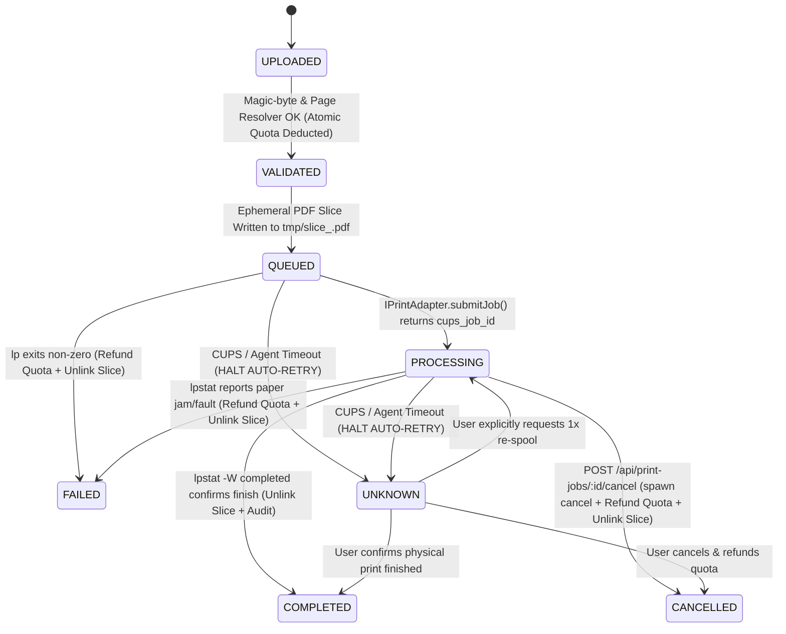

# OzPrint — Developer & Architecture Guide

This guide provides an engineering deep-dive into OzPrint's modular monolith architecture, database schema, PDF layout & slicing pipelines, and print orchestration state machine.

---

## 1. Core Engineering Philosophy

OzPrint is designed around a single guiding principle:

> **Modular Monolith Simplicity with Enterprise Security Boundaries**: OzPrint must remain simple enough to run on a single bare-metal Ubuntu/Debian homelab laptop or a single Docker container using SQLite in WAL mode, while enforcing strict OS sandboxing, RBAC isolation, and idempotent print orchestration suitable for multi-user offices, ERP integrations, and walk-up kiosks.

---

## 2. Monorepo Workspace Layout

```text
ozprint/
├── package.json                  # npm workspaces root (@ozprint/server, @ozprint/web, @ozprint/agent)
├── tsconfig.base.json            # Shared strict TypeScript compiler config
├── vitest.config.ts              # Vitest test runner configuration
├── AGENTS.md                     # Remote Print Agent guide & AI Agent engineering rules
├── CONTRIBUTING.md               # Open-source contribution workflow
├── SECURITY.md                   # Security model & vulnerability disclosure
├── apps/
│   ├── server/                   # Express API, Print Orchestrator, CUPS & Remote Adapters
│   ├── web/                      # React 18 + Vite + Tailwind CSS + PDF.js + Fabric.js SPA
│   └── agent/                    # Standalone Remote Print Agent daemon (Outbound WSS)
├── workers/
│   ├── requirements.txt          # pypdf, pdf2image, Pillow
│   └── pdf_worker.py             # Python CLI worker for PDF slicing, conversion & true redaction
├── deploy/
│   ├── bare-metal/               # install.sh & systemd ozprint.service
│   └── docker/                   # Multi-stage Dockerfile & docker-compose.yml
├── docs/
│   ├── DEVELOPER_GUIDE.md        # This guide
│   └── API_REFERENCE.md          # REST & WebSocket API specification
└── tests/
    ├── helpers/MockCupsAdapter.ts
    ├── unit/pageResolver.test.ts
    ├── security/security.test.ts
    └── integration/orchestrator.test.ts
```

---

## 3. Core Subsystems Deep-Dive

### 3.1 Deterministic Page-Range, Odd/Even & Reverse Resolver
Located in [`apps/server/src/core/pageResolver.ts`](../apps/server/src/core/pageResolver.ts):

- Resolves page selection **in the backend before CUPS submission** so custom ranges combine deterministically with odd/even filters, reverse ordering, and duplex physical sheet calculation across all printer drivers.
- Execution pipeline:
  1. Validates `totalPages >= 1` and `1 <= copies <= 100`.
  2. Expands custom range tokens (e.g. `"1-6, 9, 11-12"`) into a 1-based array of page numbers, throwing typed errors (`PAGE_OUT_OF_BOUNDS`, `INVALID_PAGE_RANGE`, `MALFORMED_RANGE_TOKEN`, `RANGE_EXCEEDS_MAX_SEGMENTS`) on invalid inputs.
  3. Applies subset filtering (`all`, `odd`, or `even`). Throws `EMPTY_RESOLVED_PAGE_SET` if no pages remain.
  4. Reverses the ordered array (`N → 1`) when `reverse: true` to support face-up manual duplexing on single-sided printers.
  5. Computes `logicalPageCount = pages.length` and `physicalSheets = (duplex === 'none' ? logicalPageCount : Math.ceil(logicalPageCount / 2)) * copies`.

### 3.2 Multiple Pages Per Sheet (N-Up Vector Layout Engine)
Located in [`apps/server/src/services/pdfWorkerService.ts`](../apps/server/src/services/pdfWorkerService.ts) (`generateNupPdf`) and [`apps/web/src/components/NupLayoutPanel.tsx`](../apps/web/src/components/NupLayoutPanel.tsx):

- Embeds source pages as lossless vector PDF Form XObjects (`outDoc.embedPages`) onto target sheets (`A4`, `A3`, `A5`, `Letter`, `Legal`).
- Supports `2`, `4`, `6`, `8`, `9`, and `16` pages per sheet.
- **Automatic Orientation**: Automatically selects Landscape for asymmetric grids (`2`, `6`, `8` pages/sheet) and Portrait for square grids (`4`, `9`, `16` pages/sheet), or respects explicit `portrait` / `landscape` overrides.
- **Reading Direction Matrix**: Supports `Row by row` vs. `Column by column` combined with `Left to right` vs. `Right to left`.
- **Precision Margin Math**: Converts user-supplied outer margins (`Top`, `Bottom`, `Left`, `Right` in `mm`) and inner sub-page spacing (`innerMarginMm` in `mm`) to PDF points (`1 mm = 72 / 25.4 pt`), scales each page proportionally within its cell, optionally draws a `0.75 pt` cell border frame (`withBorder`), and stores the output as a non-destructive revision in the user's library.

### 3.3 Visual Masking vs. True Redaction
OzPrint explicitly separates non-destructive annotation from cryptographic/raster redaction:

| Operation | Endpoint | Implementation | Underlying Vector/Text Data |
| :--- | :--- | :--- | :--- |
| **Visual Markup & Masking** | `POST /api/documents/:docId/annotate` | Flattens text, stamps, signatures, and white-box overlays onto a new PDF revision using `pdf-lib`. | Preserved underneath visual overlays. |
| **True Redaction** | `POST /api/documents/:docId/redact` | Rasterizes affected pages at 300 DPI via `workers/pdf_worker.py redact`, burns opaque rectangles into the pixel buffer, and rebuilds the page. | **Permanently stripped** from the PDF binary. |

### 3.4 Print Job Lifecycle State Machine



---

## 4. Database Layer (SQLite WAL & PostgreSQL Compatibility)

Located in [`apps/server/src/db/schema.ts`](../apps/server/src/db/schema.ts) and [`apps/server/src/db/database.ts`](../apps/server/src/db/database.ts):

- **Default Engine**: Uses `better-sqlite3` configured with:
  ```sql
  PRAGMA journal_mode = WAL;
  PRAGMA foreign_keys = ON;
  PRAGMA busy_timeout = 5000;
  ```
- **PostgreSQL Compatibility**: All schema tables (`users`, `agents`, `printers`, `folders`, `documents`, `print_jobs`, `kiosk_sessions`, `audit_logs`) use standard ANSI SQL types (`TEXT`, `INTEGER`) and the `IDatabase` interface + `toPostgresSql()` parameter translator (`?` → `$1, $2...`).

---

## 5. Writing a Custom `IPrintAdapter`

To integrate a new print backend (e.g., direct IPP-Everywhere or a cloud print spooler), implement [`IPrintAdapter`](../apps/server/src/adapters/IPrintAdapter.ts):

```typescript
export interface IPrintAdapter {
  readonly adapterType: 'LOCAL_CUPS' | 'REMOTE_AGENT';
  discoverPrinters(): Promise<DiscoveredPrinter[]>;
  submitJob(req: PrintSubmissionRequest): Promise<PrintSubmissionResult>;
  getJobStatus(
    cupsJobId: string,
    printerSystemName: string,
    agentId?: string | null
  ): Promise<CupsJobStatusResult>;
  cancelJob(cupsJobId: string, agentId?: string | null): Promise<void>;
}
```

---

## 6. Automated Test Matrix

Run the test suite with `npm test` (or individual suites via `npm run test:unit`, `npm run test:security`, `npm run test:integration`):

1. **Unit Tests (`tests/unit/pageResolver.test.ts`)**: Verifies deterministic range parsing, odd/even filtering, reverse order, duplex sheet math, and out-of-bounds error handling.
2. **Security & Fuzzing Tests (`tests/security/security.test.ts`)**: Verifies `../../etc/passwd` path traversal rejection, cross-user RBAC isolation (`403`), shell metacharacter rejection in printer names (`400`), binary allowlist enforcement, and `audit_logs` immutability triggers.
3. **Integration Tests (`tests/integration/orchestrator.test.ts`)**: Verifies magic-byte validation, idempotent job submission (`idempotencyKey`), single quota deduction, `UNKNOWN` state transition and auto-retry halt, non-destructive markup/redaction revision lineage, N-Up multi-page per sheet layout conversion, stored PDF deletion, and walk-up QR kiosk auto-purging.
